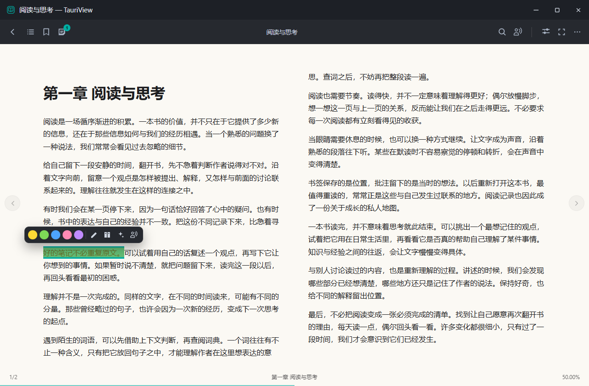
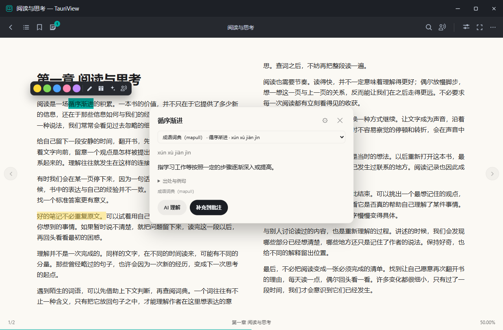
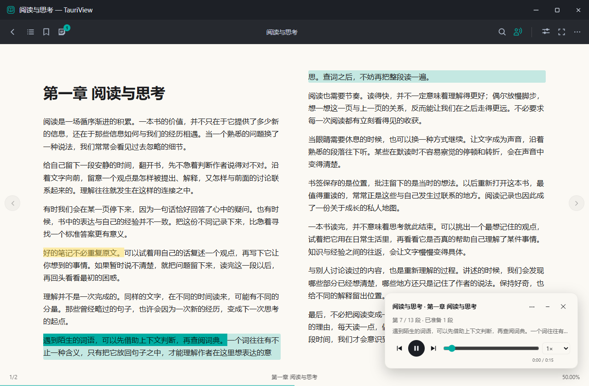

# TauriView

TauriView 是一款面向 Windows 的 EPUB / PDF 阅读器，将阅读、笔记、查词、AI 理解和听书放在同一个界面中。

书籍和阅读记录保存在本机。你可以按自己的习惯调整阅读页面，在遇到生词或难懂的段落时直接查阅、理解和记录，也可以从正在读的位置切换到听书。

以下截图使用示例图书展示实际界面。

## 舒适阅读

- 支持文字 EPUB、图片 EPUB 和 PDF。
- 文字 EPUB 可调整字体、字号、行距，选择浅色、护眼或深色主题。
- 支持单栏 / 双栏阅读，通过目录和全文搜索定位文字 EPUB 中的内容。
- 自动保存阅读进度，方便下次继续。

图片 EPUB 支持单页 / 双页浏览；PDF 当前提供基本阅读与翻页。

## 划线、批注与书签

阅读文字 EPUB 时，选中文字即可高亮、添加批注、查词、请求 AI 解释，或从这里开始听书。

重要段落可以用不同颜色标记，也可以收藏标注、添加书签，并从标注列表回到原文位置。

## 离线查词

内置英文、简体汉语和成语词典，无需联网即可查询。

- 汉语词条显示拼音，支持查看不同读音的释义。
- 成语可查看释义，以及词条收录的出处、例句等资料。
- 查询结果可补充到原文批注，也可交给 AI 结合上下文解释。
- 支持导入自己的 StarDict 词典，并在设置中管理启用状态。

内置词典的数据来源与授权见[词典说明](docs/dictionaries.md)。

## AI 帮助理解

遇到难懂的表达或段落，可以选中文字后点击「AI 理解」。软件会结合选区和邻近前文进行解释，还可以通过「举个栗子」辅助理解，并将回答补充到批注。

使用前，在「设置 → AI 理解」配置自己的服务地址、模型和 API Key。AI 功能按需使用，不影响日常阅读与离线查词。

## 从阅读切换到听书

点击阅读工具栏中搜索图标右侧的听书按钮，或选中文字后点击「从这里听」，即可从指定位置开始朗读。

- 音频分段准备，首段就绪即可播放，不必等待整章完成。
- 已生成的音频会缓存，方便再次收听。
- 支持暂停、切换段落、调整倍速和定位原文。
- 听书进度独立保存，翻页或返回书架不改变正在听的位置。
- 提供 Serena 女声和福叔男声，可在设置中切换。

本地听书目前为实验性功能，需要兼容的 NVIDIA CUDA 显卡。首次使用在「设置 → 听书」下载并准备语音组件与模型，模型约 2.5 GB，文件位置由软件管理。准备完成后，朗读在本机运行；首次加载模型仍需要等待。

当前听书支持文字 EPUB，并在本章末尾结束；PDF 和扫描件暂不支持。

## 管理书库与阅读习惯

导入书籍后，可以按分组整理书库、收藏常读的书，并通过筛选和批量操作管理书籍。

阅读统计会记录阅读时长、每日目标与连续阅读情况，帮助查看自己的阅读习惯。

## 开始使用

1. 点击书库右上角的「+」，导入 EPUB 或 PDF。
2. 打开书籍，在阅读设置中选择合适的排版与主题。
3. 阅读文字 EPUB 时，划线使用高亮、批注、词典和 AI 理解。
4. 需要听书时，先在设置中准备模型，再点击听书按钮或「从这里听」。

## 本地优先

书籍、批注、阅读进度和听书缓存保存在本机。普通阅读和内置词典查询无需联网，准备好模型后的听书也在本地完成。

只有主动使用 AI 理解时，选区及所需上下文才会发送到你配置的 AI 服务；首次准备听书组件与模型时需要联网下载。
